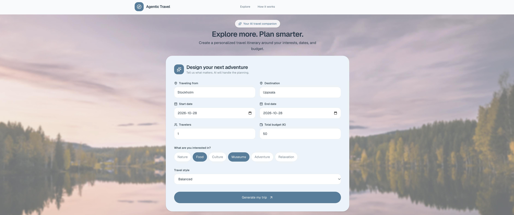
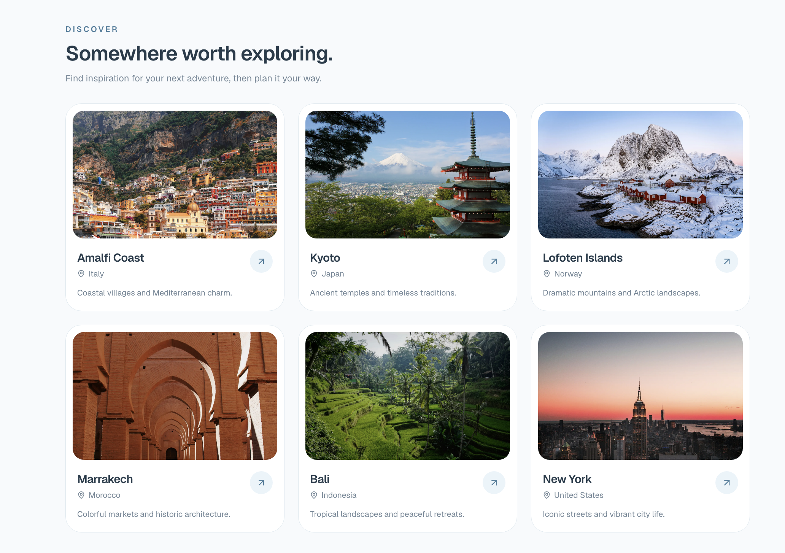
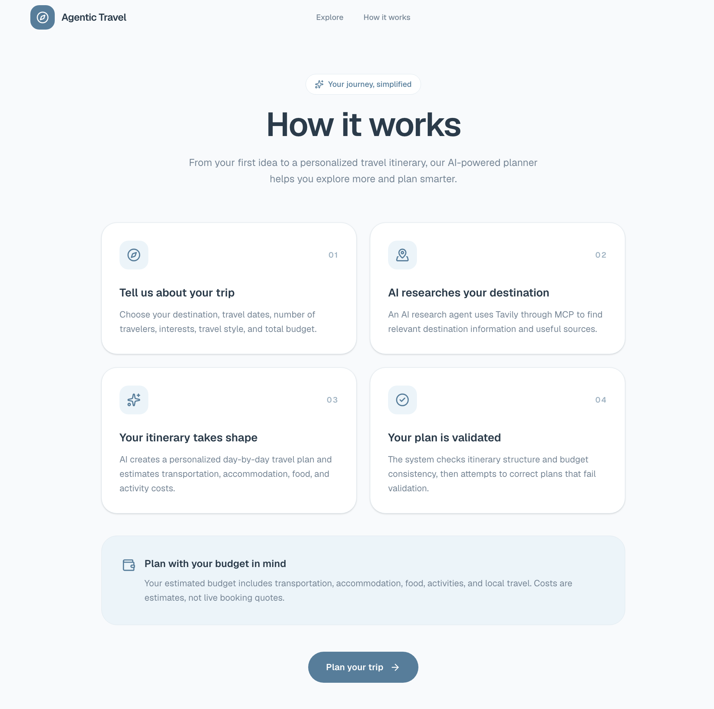
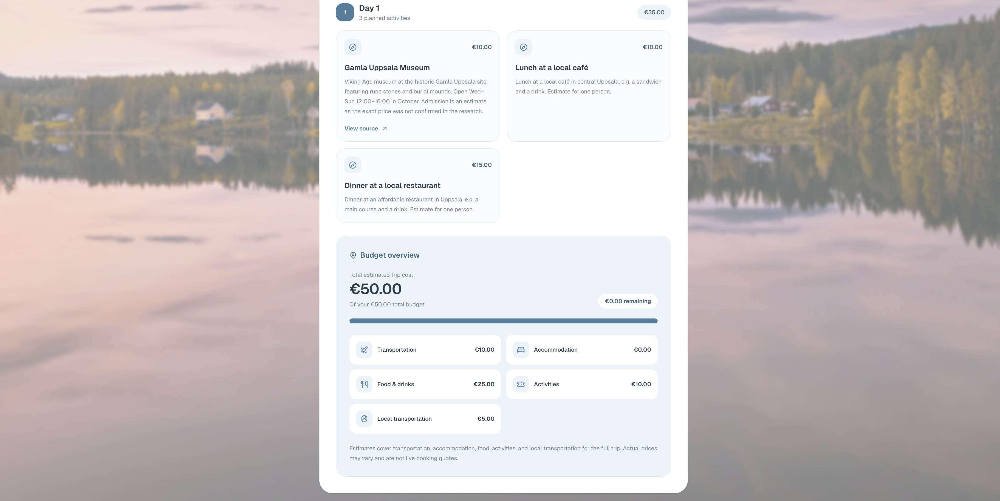
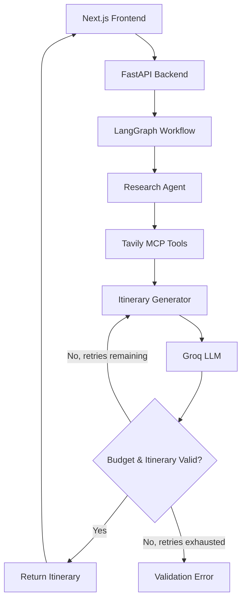

# Agentic Travel Planner

**An AI-powered full-stack application that researches destinations, generates personalized travel itineraries, and validates complete trip budgets using autonomous agents.**


**Additional technologies:** Groq, Tavily, Model Context Protocol (MCP), Pydantic, pytest.

## Demo

Watch the Agentic Travel Planner generate a personalized day trip
from Stockholm to Uppsala, including AI-powered destination research,
a structured itinerary, and a complete budget breakdown.

[▶ Watch the Demo](docs/showcase/demo.mp4)

## Application Showcase

### 1. Travel Planner

Enter your destination, travel dates, budget, interests, and travel
preferences through the responsive web interface.



### 2. Personalized Trip Configuration

Customize the trip to match your travel style and preferences before
starting the AI-powered planning process.



### 3. AI-Generated Itinerary

Explore a personalized itinerary with recommended activities,
descriptions, and supporting research sources.



### 4. Complete Budget Breakdown

Review estimated costs for transportation, accommodation, food,
activities, and local transport, validated against the trip budget.


### 5. Day-by-Day Travel Plan

Follow a structured travel schedule with activities tailored to
your selected interests and available budget.



## Quick Start

**Requirements:** Docker Desktop, [Groq API key](https://console.groq.com/keys), and [Tavily API key](https://tavily.com/).

```bash
git clone https://github.com/Eugenius0/agentic-travel-planner.git
cd agentic-travel-planner
```

Create `backend/.env`:

```env
GROQ_API_KEY=your_groq_api_key
TAVILY_API_KEY=your_tavily_api_key
GROQ_MODEL=qwen/qwen3.8-27b
```

Start the entire application:

```bash
docker compose up -d --build
```

- **Application:** http://localhost:3000
- **API documentation:** http://localhost:8000/docs

Stop with `docker compose down`.

## Features

- **AI destination research** using an autonomous LangChain agent and Tavily MCP tools.
- **Personalized itineraries** based on travel dates, departure city, destination, interests, budget, traveler count, and travel style.
- **Complete trip budgeting** covering transportation, accommodation, food, activities, and local transport.
- **Automatic validation and refinement** using LangGraph, with up to three generation attempts.
- **Research source links** for activities when supporting URLs are available.
- **Responsive web interface** with daily itineraries and visual budget breakdowns.

## Screenshots

<!-- Replace these placeholders with screenshots from the application. -->

Screenshots of the landing page, trip planning form, and generated itinerary will be added here.

## How It Works



**Architecture highlights:**

- **LangGraph:** Stateful orchestration, conditional routing, and bounded retries.
- **LangChain + MCP:** Agentic research with external tools.
- **Groq:** LLM-based structured itinerary generation.
- **FastAPI + Pydantic:** REST API, typed schemas, and validation.
- **Next.js:** Interactive frontend for trip planning and results.
- **Docker Compose:** Reproducible full-stack execution.

## Testing

The application has been verified through **automated tests and successful live end-to-end testing**.

- **Automated tests:** Cover API behavior, schema validation, LangGraph workflow transitions, budget consistency, and expense categorization. External AI services are mocked for reliable, repeatable testing.
- **Live integration tests:** Successfully verified the complete workflow, including real Groq LLM calls, Tavily MCP research, itinerary generation, budget validation, and frontend rendering.
- **Docker verification:** Successfully built and started both frontend and backend using Docker Compose.

Run backend tests:

```bash
cd backend
source .venv/bin/activate
python -m pytest -q
```

Frontend checks:

```bash
cd frontend
npm run lint
npm run build
```

## Limitations

Travel costs are AI-generated estimates, not live booking quotes. Research accuracy depends on external sources and API availability. The application does not currently support bookings, user accounts, or saved trips.

---

Development history and technical decisions are documented in [WORKLOG.md](WORKLOG.md).
