# Work log

## Project planning

- Defined the goal of building an AI-powered travel planner that generates personalized itineraries based on destinations, budgets, trip duration, and user interests.
- Selected FastAPI for the backend and Next.js with TypeScript for the planned frontend.
- Selected LangChain for LLM integration, LangGraph for agentic workflow orchestration, and MCP for external tool integration.
- Planned a workflow consisting of destination research, itinerary generation, budget validation, and conditional refinement.
- Decided to introduce technologies incrementally and only when they provide a clear architectural benefit.
- Deferred Redis, RabbitMQ, Kafka, and Kubernetes because the initial application does not require distributed caching, message queues, event streaming, or container orchestration.

## Repository setup

- Created the `agentic-travel-planner` project directory.
- Initialized a Git repository and configured `main` as the default branch.
- Created the initial backend structure with separate application and test directories.
- Added `README.md` and `WORKLOG.md` for project documentation and development tracking.
- Configured `.gitignore` to exclude virtual environments, generated files, IDE settings, and environment variables.
- Verified that Git ignores the local Python virtual environment.

## Python environment

- Created and activated a Python virtual environment using Python 3.14.
- Installed FastAPI, Uvicorn, pytest, and HTTPX.
- Generated `requirements.txt` to record the installed dependencies.
- Selected Python 3.12 for the Docker environment to provide a consistent runtime independently of the locally installed Python version.

## Backend setup

- Created the FastAPI application in `backend/app/main.py`.
- Configured the application title, description, and version.
- Implemented a `GET /health` endpoint returning `{"status":"ok"}`.
- Selected Uvicorn as the ASGI server, consistent with the approach used in the previous Solvigo project.
- Started the backend locally using Uvicorn.
- Verified that the health endpoint returns the expected response.
- Confirmed that FastAPI automatically generates interactive API documentation through Swagger UI.

## Docker setup

- Created a Dockerfile based on `python:3.12-slim`.
- Configured the container working directory and Python environment variables.
- Installed backend dependencies from `requirements.txt`.
- Configured a non-root user to run the application.
- Configured Uvicorn to serve FastAPI on port 8000.
- Added `.dockerignore` to exclude unnecessary files from the Docker build context.
- Encountered a Docker daemon connection error because Docker Desktop was not running.
- Started Docker Desktop and confirmed that the Docker daemon was available.
- Encountered a missing Dockerfile error during the initial build.
- Created the Dockerfile in the backend directory and successfully built the Docker image.
- Started the backend container and verified that `/health` returns `{"status":"ok"}`.
- Configured an explicit container name instead of using Docker's automatically generated names.
- Removed the `--rm` flag to preserve stopped containers in Docker Desktop.
- Configured detached execution using `-d` to run the container in the background.

## Automated testing

- Added pytest and HTTPX as testing dependencies.
- Created `backend/tests/test_health.py`.
- Implemented a test using FastAPI's `TestClient`.
- Added assertions for HTTP status 200 and the expected JSON response.
- Automated test execution result to be confirmed.

## Documentation

- Created a README describing the project goals, features, and planned architecture.
- Documented implemented and planned technologies separately.
- Added instructions for running the backend locally and through Docker.
- Documented the reasoning behind FastAPI, Uvicorn, and Docker.
- Documented the decision to avoid unnecessary infrastructure during the initial development phase.
- Established this work log to track implementation progress alongside Git commits.

## GitHub setup

- Pending: Create the initial Git commit.
- Pending: Create a public GitHub repository.
- Pending: Push the project to the `main` branch.

## Docker Compose setup

- Added `compose.yaml` to manage application services.
- Configured Docker Compose to build and run the FastAPI backend.
- Enabled automatic container restart unless explicitly stopped.
- Verified that `docker compose up -d --build` successfully builds and starts the backend.
- Confirmed that `/health` returns `{"status":"ok"}` through the Compose-managed container.
- Established a foundation for adding the frontend as a separate service.

## Travel request API

- Defined a Pydantic schema for destination, trip duration, budget, currency, and interests.
- Added `POST /api/trips/plan` with automatic request validation.
- Verified successful requests through FastAPI's interactive API documentation.
- Added automated tests for valid requests, negative budgets, and empty interests.
- Confirmed that all four backend tests pass.

## LLM integration

- Selected Groq as the LLM provider and Qwen3.8-27B as the initial model.
- Configured the API key and model through environment variables.
- Added `.env.example` for reproducible configuration without exposing credentials.
- Integrated LangChain using `langchain-groq`.
- Created a reusable LLM configuration module.
- Successfully verified a Groq API request that generated travel recommendations for Stockholm.

## Structured itinerary generation

- Defined Pydantic response schemas for travel itineraries, daily plans, and activities.
- Integrated LangChain structured output with Groq to generate personalized itineraries.
- Connected the AI itinerary generator to the FastAPI `/api/trips/plan` endpoint.
- Configured Docker Compose to load Groq environment variables.
- Verified successful itinerary generation through the API.
- Updated API tests to mock LLM responses, keeping tests fast and independent of external services.
- Confirmed all 4 automated tests pass.
  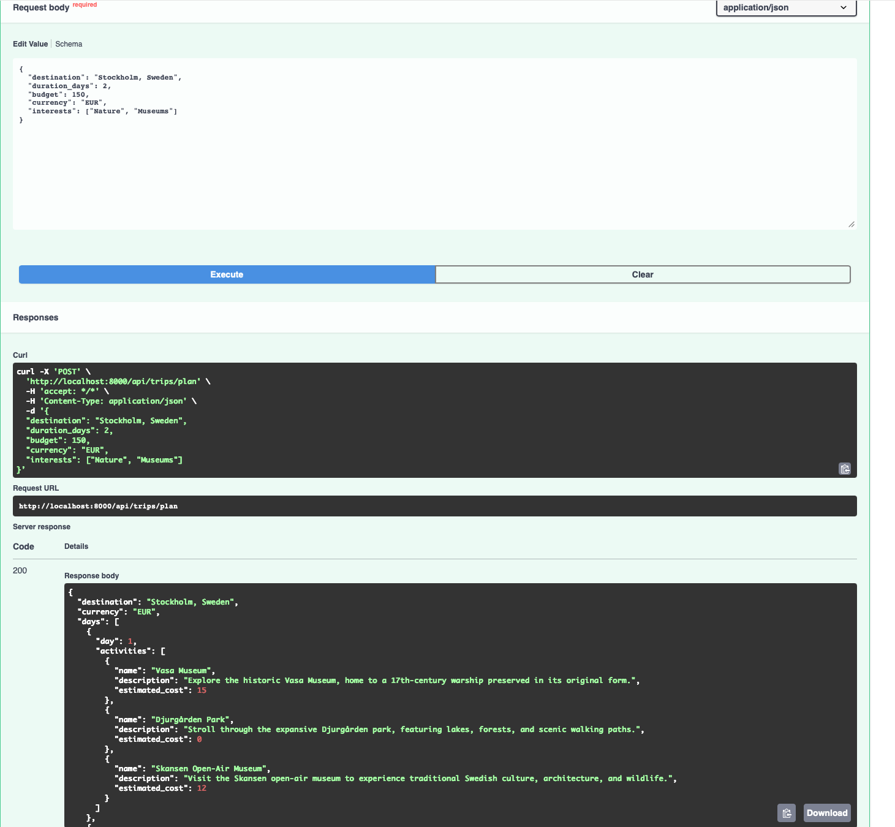

## LangGraph workflow

- Integrated LangGraph for stateful travel planning orchestration.
- Defined shared workflow state for requests, itineraries, validation errors, and retry counts.
- Implemented itinerary generation and deterministic validation nodes.
- Added validation for trip duration, day ordering, currency, cost totals, and budget limits.
- Implemented conditional routing with a maximum of three generation attempts.
- Verified itinerary generation, validation, and routing independently.

## LangGraph API integration

- Connected the FastAPI travel planning endpoint to the LangGraph workflow.
- Added automatic itinerary regeneration when validation fails, limited to three attempts.
- Configured the API to return HTTP 422 when itinerary validation fails after all attempts.
- Updated API tests to mock LangGraph execution without external LLM calls.
- Verified successful itinerary generation through Docker Compose.
- Confirmed all 5 automated tests pass.

## LangGraph workflow testing

- Added automated tests for the compiled LangGraph workflow.
- Verified successful itinerary generation on the first attempt.
- Verified automatic regeneration after an invalid itinerary.
- Confirmed generation stops after three unsuccessful attempts.
- Mocked LLM responses to keep tests deterministic and independent of Groq.
- Confirmed all 8 automated tests pass.

## Tavily MCP integration

- Integrated the LangChain MCP client for external research tools.
- Configured authenticated access to Tavily's hosted MCP server.
- Successfully discovered five MCP tools: search, extract, crawl, map, and research.
- Executed a live destination research query through MCP.
- Retrieved attraction information, admission prices, and source URLs.
- Configured Tavily API access through environment variables.
- Previously, Qwen generated prices based on its existing knowledge. Now we can provide it with researched information and source URLs

## LangGraph destination research integration

- Added an asynchronous destination research node using Tavily MCP.
- Extracted relevant source titles, URLs, and content from search results.
- Integrated research into the LangGraph workflow before itinerary generation.
- Updated Qwen prompts to use retrieved destination information.
- Kept research outside the validation retry loop to avoid redundant searches.
- Updated FastAPI to execute the graph asynchronously.
- Added mocked asynchronous tests for research integration and API responses.
- Verified all 8 automated tests pass without external API calls.

## End-to-end travel planning verification

- Successfully tested the complete FastAPI, Tavily MCP, Qwen, and LangGraph workflow using Docker Compose.
- Generated a two-day Stockholm itinerary with six activities based on the requested interests.
- Confirmed that the generated activity costs total 54 EUR, within the 150 EUR budget.
- Verified that the API returns a structured itinerary with the correct duration and currency.

## Autonomous Research Agent

- Implemented a LangChain research agent using Qwen through Groq.
- Integrated Tavily MCP for dynamically selected web searches.
- Added configurable limits for search attempts and agent execution steps.
- Simplified the search tool schema to improve tool-calling reliability.
- Added error handling for failed searches and MCP error responses.
- Reduced token consumption by extracting concise source information.
- Integrated the Research Agent into the LangGraph travel-planning workflow.
- Verified the integration with mocked tests.
- All 13 backend tests passing.

### Known Limitations

- Qwen tool calling can occasionally produce malformed requests.
- Research quality depends on the reliability of retrieved sources.
- Groq free-tier rate limits can affect multi-step agent execution.
- Live end-to-end testing of the newly integrated workflow is still pending.

## Itinerary Quality Improvements

- Added validation coverage for inconsistent itinerary cost totals.
- Added optional source URLs to itinerary activities.
- Updated the itinerary generation prompt to use research-backed URLs without inventing sources.
- Added schema tests for valid, missing, and invalid source URLs.
- All 17 backend tests passing.

## Full-Trip Budget Foundation

- Extended travel requests with departure city, travel dates, traveler count, and travel style.
- Added date validation and preserved compatibility with existing requests.
- Introduced a structured trip cost breakdown covering transportation, accommodation, food, activities, and local transportation.
- Added an optional cost breakdown to itinerary responses.
- Added automated tests for travel requests and cost calculations.
- All 23 backend tests passing.

## Full-Trip Budget Validation

- Added validation for complete trip costs against the user's budget.
- Ensured activity costs in the breakdown match the itinerary.
- Added automated tests for exceeding the total budget and inconsistent activity subtotals.
- Preserved compatibility with existing itineraries.
- All 25 backend tests passing.

## Frontend Foundation

- Initialized Next.js with React, TypeScript, Tailwind CSS, and ESLint.
- Adopted the Next.js App Router for frontend routing.
- Established the foundation for a responsive travel-planning interface.

## Frontend Design Foundation

- Established a reusable design system with custom colors, spacing, and styling tokens.
- Configured Geist typography and application metadata.
- Created a reusable navigation component using Next.js and Lucide React.
- Implemented the initial responsive homepage with branding and introductory content.
- Verified the frontend renders successfully in development.
  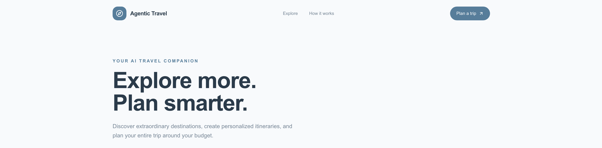

## Homepage Landing Section

- Implemented a responsive two-column landing section with destination photography.
- Added navigation actions and a floating information card.
- Integrated Next.js Image for optimized image rendering.
- Organized static assets under `frontend/public/images/`.
- Verified the homepage renders successfully.

## Destination Discovery

- Created a reusable destination card component with photography, location details, and hover interactions.
- Added the initial Discover section to the homepage.
- Established the homepage structure around trip planning, destination discovery, and product information.

## Destination Discovery Expansion

- Expanded the Discover section to six destinations across different climates and cultures.
- Added destination photography and reusable card data.
- Implemented a responsive grid for destination discovery.
- Identified card sizing and layout issues for the next UI refinement.
  

## Interactive Trip Planner

- Implemented a responsive trip-planning form using React and TypeScript.
- Added departure city, destination, travel dates, traveler count, and budget inputs.
- Implemented selectable travel interests and travel style preferences.
- Added client-side form validation and state management.
- Integrated the planner into the homepage above destination discovery.
- Verified form interactions and responsive layout.
  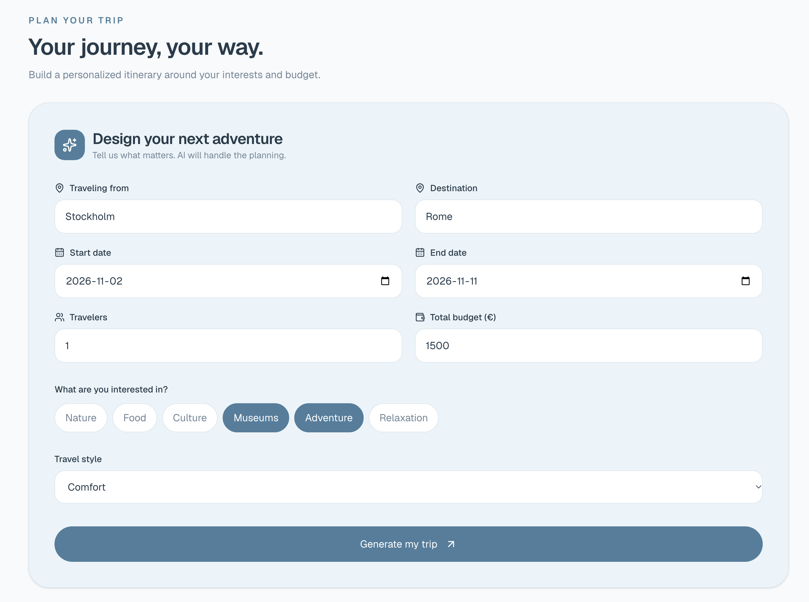

## Frontend–Backend Integration

- Created a typed API client for communication with FastAPI.
- Configured the frontend API URL using environment variables.
- Enabled CORS for local Next.js development.
- Connected the trip planner form to the backend endpoint.
- Added trip duration calculation and input validation.
- Implemented loading, error, and response states.
- Verified TypeScript compilation and all 26 backend tests.

## Frontend–Backend Integration Verification

- Verified communication between Next.js and FastAPI.
- Resolved CORS preflight handling for local development.
- Tested trip submission using a temporary mocked backend response.
- Confirmed correct travel duration calculation and API response rendering.
- Verified the integration without consuming external AI API credits.
- Restored the LangGraph-powered backend after testing.
  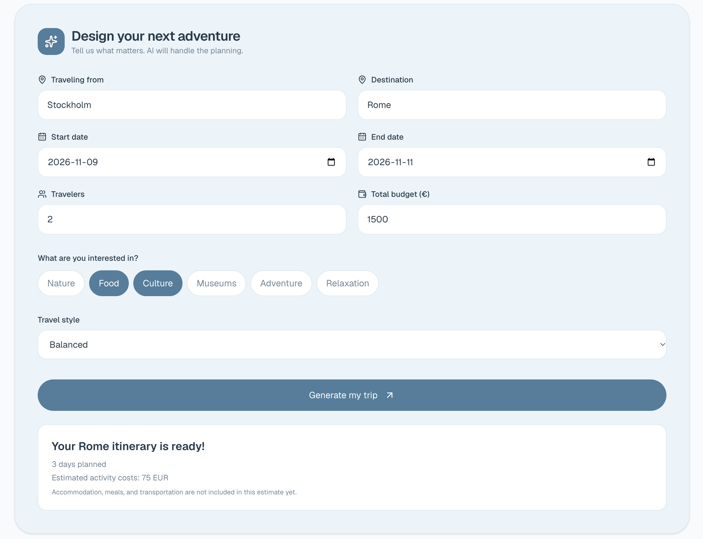

## Itinerary Results Interface

- Built a reusable React component for generated travel itineraries.
- Added day-by-day activity cards with descriptions and estimated costs.
- Implemented daily cost totals and an activity budget overview.
- Added support for displaying research source links.
- Integrated itinerary results with the trip planner form.
- Verified the interface using mocked backend responses.
- Preserved the existing responsive design system.
  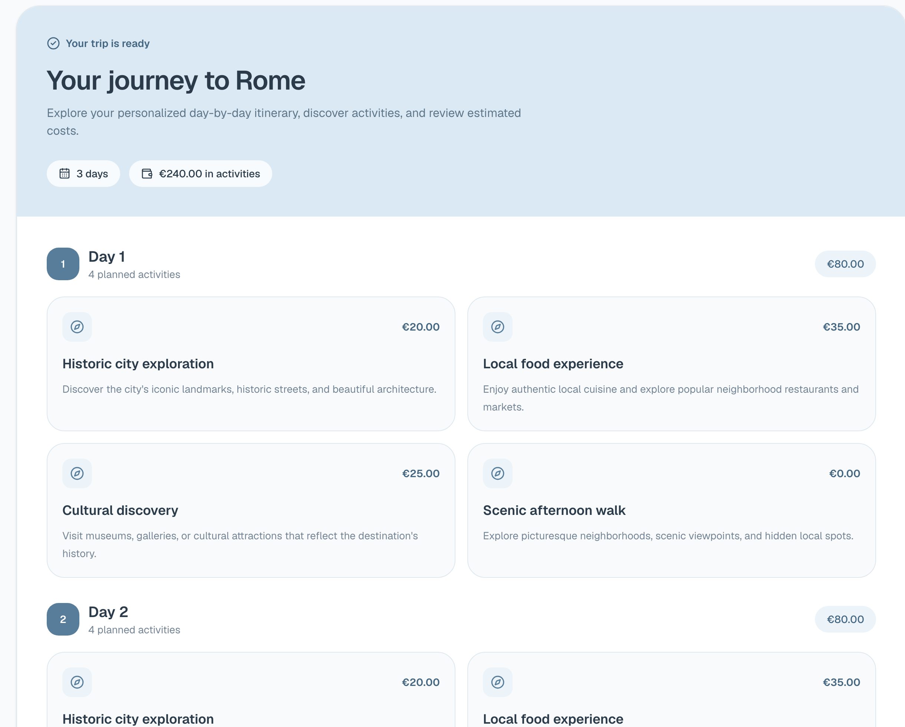
  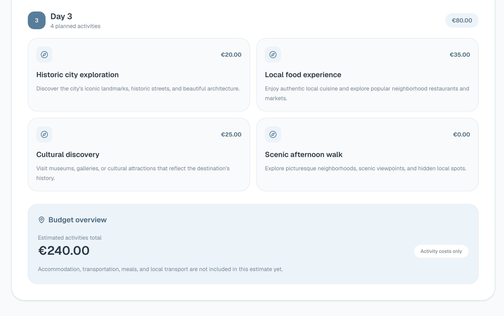

### Complete Trip Budgeting

- Extended itinerary generation to estimate transportation, accommodation, food, activities, and local transportation.
- Added full-trip budget validation and feedback-driven LangGraph retries.
- Updated the frontend with a complete cost breakdown, budget progress indicator, and remaining budget.
- Verified backend tests (30 passed), TypeScript, and ESLint.
  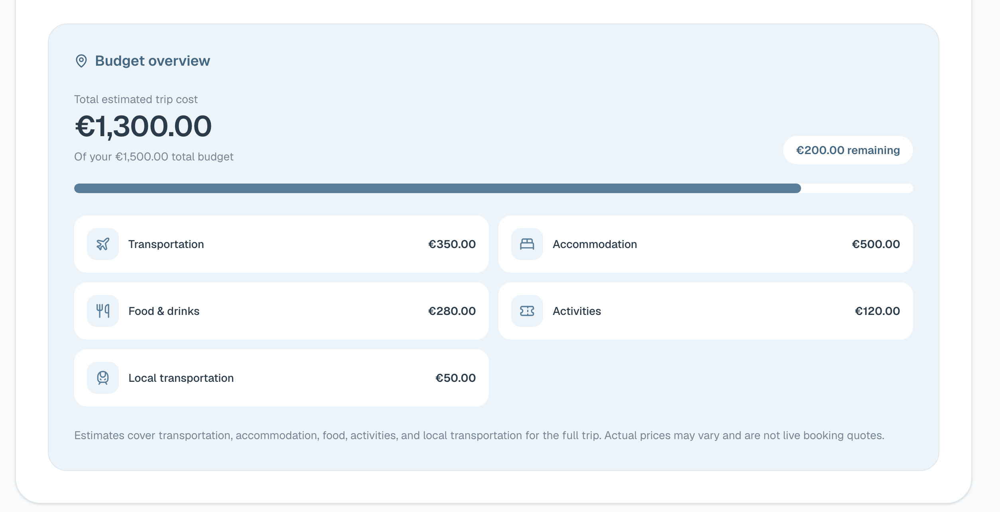

### Successful End-to-End Integration

- Completed the first successful live test of the full travel planning workflow.
- Fixed environment variable loading and adjusted Groq token limits and retry handling.
- Verified LangGraph orchestration, Tavily MCP research, Groq itinerary generation, and backend validation.
- Confirmed the frontend displays real itineraries, source links, and complete trip budget breakdowns.
- Identified an issue where meal expenses are incorrectly categorized as activities.
- Next thing is to fix minor bugs in the result and finalizing MVP
  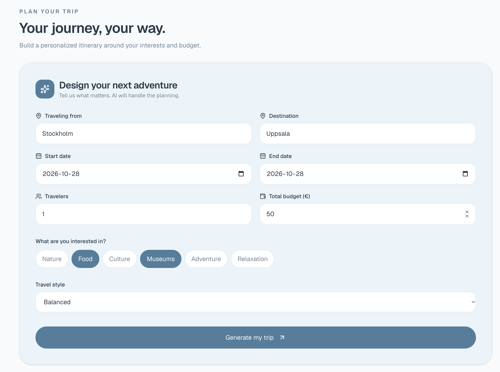
  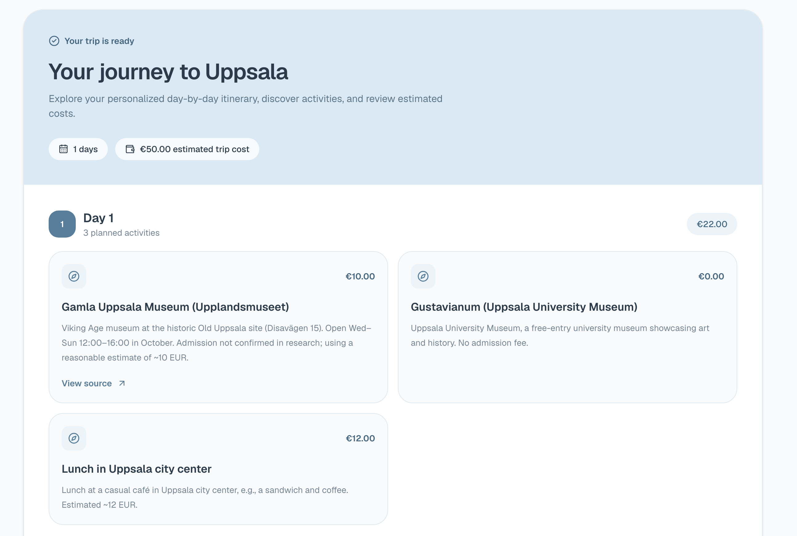
  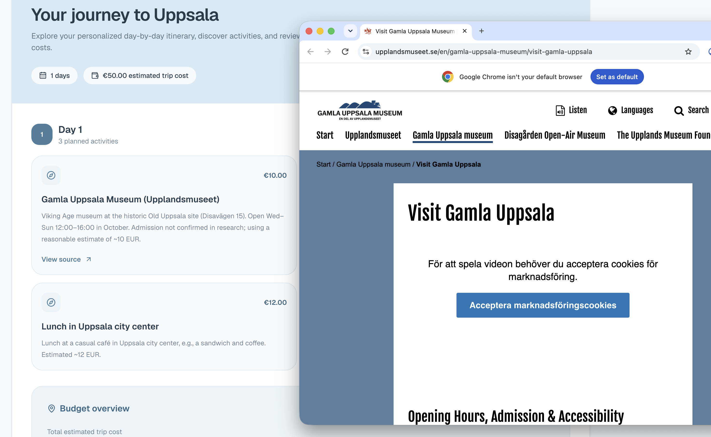
  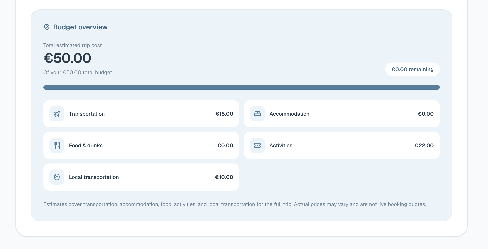

### Budget Categorization

- Added separate food and activity expense categorization.
- Updated budget validation to prevent meal expenses from being incorrectly allocated to activities.
- Added regression tests for expense categorization and food budget validation.

### MVP Reliability and Docker Compose Integration

- Added error handling for Groq rate limits, API timeouts, connection failures, and unexpected backend errors.
- Verified backend functionality with automated pytest tests.
- Added regression tests for food and activity budget categorization.
- Added a production Dockerfile and .dockerignore for the Next.js frontend.
- Extended Docker Compose to run both frontend and backend services.
- Configured environment variables and frontend API connectivity.
- Successfully built and started both services using Docker Compose.
- Next: finalize README documentation and complete MVP verification.

### Final MVP UI Improvements

- Added a How It Works page explaining the AI research, itinerary generation, and validation workflow.
- Made destination cards clickable, linking directly to the trip planner.
- Redesigned the homepage to prioritize the trip planning form.
- Added a scenic landscape background with subtle blur and transparency.
- Improved responsive spacing to better accommodate the form on desktop screens.
- Simplified the navbar and removed the redundant Plan a Trip button.
- Prepared the application for final screenshots and a video showcase.
