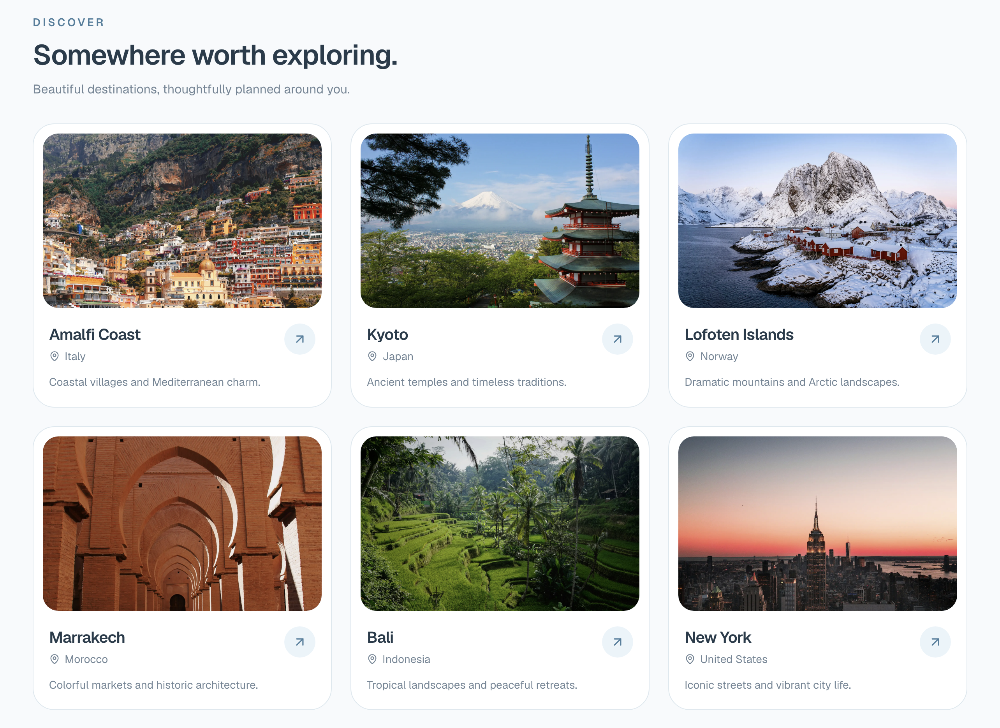

# Work log

## Project planning

- Defined the goal of building an AI-powered travel planner that generates personalized itineraries based on destinations, budgets, trip duration, and user interests.
- Selected FastAPI for the backend and Next.js with TypeScript for the planned frontend.
- Selected LangChain for LLM integration, LangGraph for agentic workflow orchestration, and MCP for external tool integration.
- Planned a workflow consisting of destination research, itinerary generation, budget validation, and conditional refinement.
- Decided to introduce technologies incrementally and only when they provide a clear architectural benefit.
- Deferred Redis, RabbitMQ, Kafka, and Kubernetes because the initial application does not require distributed caching, message queues, event streaming, or container orchestration.

## Repository setup

- Created the `agentic-travel-planner` project directory.
- Initialized a Git repository and configured `main` as the default branch.
- Created the initial backend structure with separate application and test directories.
- Added `README.md` and `WORKLOG.md` for project documentation and development tracking.
- Configured `.gitignore` to exclude virtual environments, generated files, IDE settings, and environment variables.
- Verified that Git ignores the local Python virtual environment.

## Python environment

- Created and activated a Python virtual environment using Python 3.14.
- Installed FastAPI, Uvicorn, pytest, and HTTPX.
- Generated `requirements.txt` to record the installed dependencies.
- Selected Python 3.12 for the Docker environment to provide a consistent runtime independently of the locally installed Python version.

## Backend setup

- Created the FastAPI application in `backend/app/main.py`.
- Configured the application title, description, and version.
- Implemented a `GET /health` endpoint returning `{"status":"ok"}`.
- Selected Uvicorn as the ASGI server, consistent with the approach used in the previous Solvigo project.
- Started the backend locally using Uvicorn.
- Verified that the health endpoint returns the expected response.
- Confirmed that FastAPI automatically generates interactive API documentation through Swagger UI.

## Docker setup

- Created a Dockerfile based on `python:3.12-slim`.
- Configured the container working directory and Python environment variables.
- Installed backend dependencies from `requirements.txt`.
- Configured a non-root user to run the application.
- Configured Uvicorn to serve FastAPI on port 8000.
- Added `.dockerignore` to exclude unnecessary files from the Docker build context.
- Encountered a Docker daemon connection error because Docker Desktop was not running.
- Started Docker Desktop and confirmed that the Docker daemon was available.
- Encountered a missing Dockerfile error during the initial build.
- Created the Dockerfile in the backend directory and successfully built the Docker image.
- Started the backend container and verified that `/health` returns `{"status":"ok"}`.
- Configured an explicit container name instead of using Docker's automatically generated names.
- Removed the `--rm` flag to preserve stopped containers in Docker Desktop.
- Configured detached execution using `-d` to run the container in the background.

## Automated testing

- Added pytest and HTTPX as testing dependencies.
- Created `backend/tests/test_health.py`.
- Implemented a test using FastAPI's `TestClient`.
- Added assertions for HTTP status 200 and the expected JSON response.
- Automated test execution result to be confirmed.

## Documentation

- Created a README describing the project goals, features, and planned architecture.
- Documented implemented and planned technologies separately.
- Added instructions for running the backend locally and through Docker.
- Documented the reasoning behind FastAPI, Uvicorn, and Docker.
- Documented the decision to avoid unnecessary infrastructure during the initial development phase.
- Established this work log to track implementation progress alongside Git commits.

## GitHub setup

- Pending: Create the initial Git commit.
- Pending: Create a public GitHub repository.
- Pending: Push the project to the `main` branch.

## Docker Compose setup

- Added `compose.yaml` to manage application services.
- Configured Docker Compose to build and run the FastAPI backend.
- Enabled automatic container restart unless explicitly stopped.
- Verified that `docker compose up -d --build` successfully builds and starts the backend.
- Confirmed that `/health` returns `{"status":"ok"}` through the Compose-managed container.
- Established a foundation for adding the frontend as a separate service.

## Travel request API

- Defined a Pydantic schema for destination, trip duration, budget, currency, and interests.
- Added `POST /api/trips/plan` with automatic request validation.
- Verified successful requests through FastAPI's interactive API documentation.
- Added automated tests for valid requests, negative budgets, and empty interests.
- Confirmed that all four backend tests pass.

## LLM integration

- Selected Groq as the LLM provider and Qwen3.8-27B as the initial model.
- Configured the API key and model through environment variables.
- Added `.env.example` for reproducible configuration without exposing credentials.
- Integrated LangChain using `langchain-groq`.
- Created a reusable LLM configuration module.
- Successfully verified a Groq API request that generated travel recommendations for Stockholm.

## Structured itinerary generation

- Defined Pydantic response schemas for travel itineraries, daily plans, and activities.
- Integrated LangChain structured output with Groq to generate personalized itineraries.
- Connected the AI itinerary generator to the FastAPI `/api/trips/plan` endpoint.
- Configured Docker Compose to load Groq environment variables.
- Verified successful itinerary generation through the API.
- Updated API tests to mock LLM responses, keeping tests fast and independent of external services.
- Confirmed all 4 automated tests pass.
  

## LangGraph workflow

- Integrated LangGraph for stateful travel planning orchestration.
- Defined shared workflow state for requests, itineraries, validation errors, and retry counts.
- Implemented itinerary generation and deterministic validation nodes.
- Added validation for trip duration, day ordering, currency, cost totals, and budget limits.
- Implemented conditional routing with a maximum of three generation attempts.
- Verified itinerary generation, validation, and routing independently.

## LangGraph API integration

- Connected the FastAPI travel planning endpoint to the LangGraph workflow.
- Added automatic itinerary regeneration when validation fails, limited to three attempts.
- Configured the API to return HTTP 422 when itinerary validation fails after all attempts.
- Updated API tests to mock LangGraph execution without external LLM calls.
- Verified successful itinerary generation through Docker Compose.
- Confirmed all 5 automated tests pass.

## LangGraph workflow testing

- Added automated tests for the compiled LangGraph workflow.
- Verified successful itinerary generation on the first attempt.
- Verified automatic regeneration after an invalid itinerary.
- Confirmed generation stops after three unsuccessful attempts.
- Mocked LLM responses to keep tests deterministic and independent of Groq.
- Confirmed all 8 automated tests pass.

## Tavily MCP integration

- Integrated the LangChain MCP client for external research tools.
- Configured authenticated access to Tavily's hosted MCP server.
- Successfully discovered five MCP tools: search, extract, crawl, map, and research.
- Executed a live destination research query through MCP.
- Retrieved attraction information, admission prices, and source URLs.
- Configured Tavily API access through environment variables.
- Previously, Qwen generated prices based on its existing knowledge. Now we can provide it with researched information and source URLs

## LangGraph destination research integration

- Added an asynchronous destination research node using Tavily MCP.
- Extracted relevant source titles, URLs, and content from search results.
- Integrated research into the LangGraph workflow before itinerary generation.
- Updated Qwen prompts to use retrieved destination information.
- Kept research outside the validation retry loop to avoid redundant searches.
- Updated FastAPI to execute the graph asynchronously.
- Added mocked asynchronous tests for research integration and API responses.
- Verified all 8 automated tests pass without external API calls.

## End-to-end travel planning verification

- Successfully tested the complete FastAPI, Tavily MCP, Qwen, and LangGraph workflow using Docker Compose.
- Generated a two-day Stockholm itinerary with six activities based on the requested interests.
- Confirmed that the generated activity costs total 54 EUR, within the 150 EUR budget.
- Verified that the API returns a structured itinerary with the correct duration and currency.

## Autonomous Research Agent

- Implemented a LangChain research agent using Qwen through Groq.
- Integrated Tavily MCP for dynamically selected web searches.
- Added configurable limits for search attempts and agent execution steps.
- Simplified the search tool schema to improve tool-calling reliability.
- Added error handling for failed searches and MCP error responses.
- Reduced token consumption by extracting concise source information.
- Integrated the Research Agent into the LangGraph travel-planning workflow.
- Verified the integration with mocked tests.
- All 13 backend tests passing.

### Known Limitations

- Qwen tool calling can occasionally produce malformed requests.
- Research quality depends on the reliability of retrieved sources.
- Groq free-tier rate limits can affect multi-step agent execution.
- Live end-to-end testing of the newly integrated workflow is still pending.
